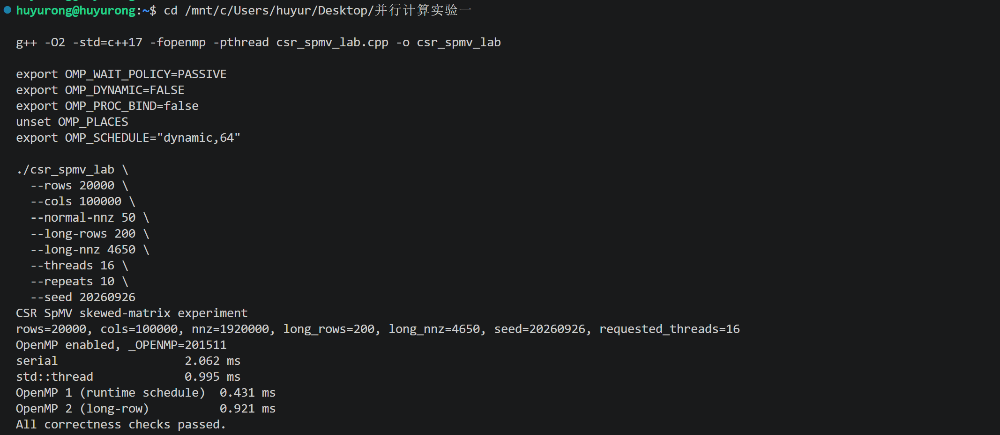

# OpenMP CSR SpMV 并行编程实验报告

## 1. 实验目标与策略

CSR SpMV 按行计算稀疏矩阵向量乘 `y = Ax`，每行独立写入 `y[row]`，适合按行并行。

Skewed CSR 中的负载不均主要有行间负载不均和单条长行瓶颈两种表现形式，所以实验采用两种 OpenMP 并行组织：

- **行级 runtime scheduling**：`spmv_omp_student_1` 使用 `schedule(runtime)`，通过 dynamic/guided 和 chunk 调整行分配缓解行间负载不均。
- **Long-row splitting**：`spmv_omp_student_2` 让普通行由单线程整行处理，长行按 NNZ 区间拆给同一 OpenMP team 中的多个线程。各线程计算 partial sums，经过 barrier 后 merge，缓解单条长行瓶颈。

## 2. 实验环境与公平性

- CPU：Intel Core Ultra 9 285H。
- 系统：WSL Ubuntu，16 CPUs / 16 cores / 1 thread per core，24 MiB shared L3。
- 编译器：GCC 15.2.0 / libgomp，编译命令：

  ```bash
  g++ -O2 -std=c++17 -fopenmp -pthread csr_spmv_lab.cpp -o csr_spmv_lab
  ```

- OpenMP 环境：`OMP_WAIT_POLICY=PASSIVE`、`OMP_DYNAMIC=FALSE`、`OMP_PROC_BIND=false`，`OMP_PLACES unset`。
- 计时方法：每个进程 warm-up 1 次，正式调用 10 次取平均；每组配置运行 5 个独立进程，报告中位数。不同策略使用相同矩阵、编译选项和运行环境，所有正式配置均通过正确性检查。
- 实验变量：线程数 `1,2,4,8,16`，dynamic/guided 的 chunk 为 `1,2,4,8,16,32,64`；设置 3 个 skew level、3 个矩阵规模和 3 个 seed。
- 矩阵设计：各矩阵保持 1% long rows，平均 NNZ/row 约为 96；通过改变长短行差异调整 skew，矩阵规模根据工作集与本机 24 MiB L3 的关系划分。完整参数见附录A。

实验以 medium、seed=20260926 为主配置，进一步改变矩阵规模和 seed 验证结果的稳定性。

## 3. 实验结果

### 3.1 线程数与 skew

固定 medium、`seed=20260926`，dynamic/guided 在各线程数下取7个 chunk 中的最优 median（ms）。

| Level | Dynamic 4T | Guided 4T | Dynamic 8T | Guided 8T | Dynamic 16T | Guided 16T |
| ---: | ---: | ---: | ---: | ---: | ---: | ---: |
| 1 | 0.658 | 0.591 | 0.516 | 0.425 | 0.457 | 0.459 |
| 2 | 0.663 | 0.595 | 0.490 | 0.482 | 0.472 | 0.511 |
| 3 | 0.646 | 0.597 | 0.501 | 0.498 | 0.417 | 0.464 |

4T时 guided 在三个 Level 均领先；8T时两者差距缩小（Level 1除外）；16T时 dynamic 在 Level 2/3 领先。15组 `Level × threads` 配置中，13组至少一种策略的最优与次优 chunk 差距小于3%，说明最优 chunk 并不稳定。

16T加速比与并行效率如下（以各策略自身最优1T时间为基准）：

| Level | Dynamic 加速比/效率 | Guided 加速比/效率 | Long-row 加速比 |
| ---: | ---: | ---: | ---: |
| 1 | 5.02× / 31.37% | 5.21× / 32.56% | 3.70× |
| 2 | 4.88× / 30.51% | 4.39× / 27.46% | 3.07× |
| 3 | 5.50× / 34.37% | 4.88× / 30.50% | 2.64× |

行级调度在16T下获得约4.4–5.5倍加速，但并行效率仅为27%-34%，说明增加线程并未带来等比例收益。Long-row的16T加速比从Level 1的3.70×降至Level 3的2.64×，表明其并行扩展效果反而随行长度差异增大而变差，可能与长行拆分及同步开销有关。

### 3.2 跨规模与随机种子验证

固定16T和既定 chunk，分别改变矩阵规模及随机种子。`≈` 表示 dynamic/guided 的 median 差距小于3%。

| Level | Small / Medium / Large | Seed 20260926 / 12345 / 54321 |
| ---: | --- | --- |
| 1 | D / D≈G / D≈G | D≈G / G / D≈G |
| 2 | D≈G / D / D | D / G / D |
| 3 | G / D / G | D / D / G |

*D = dynamic，G = guided；完整运行时间见附录C。*

Level 3在规模变化时出现 G→D→G 的翻转；Level 2、3在不同 seed 下也出现胜出策略变化，说明单一配置下的性能排序不能直接推广。Long-row 在规模和 seed 验证的18组场景中均未领先。

## 4. 优化诊断与负优化

### 4.1 16线程异常

早期实验中发现dynamic/guided 到16T时突然变慢，long-row 退化更严重。确认 WSL 可见16核后，对8/10/12/14/16线程进行复测并比较 wait policy 与线程绑定设置。

发现未显式设置 wait policy 与显式设置 `OMP_WAIT_POLICY=PASSIVE` 的表现差异明显；显式 PASSIVE 后16T异常消失。因此正式实验统一采用该设置。

### 4.2 Long-row负优化

旧版 long-row 频繁同步，16T下性能严重退化。重构后只建立一个 OpenMP team，普通行直接计算，各线程批量计算所有 long rows 中分给自己的 NNZ 区间，生成 partial sums；一次同步后并行 merge 各条长行。同步次数降为 `O(1)`，之前的严重性能下降消失，但仍未超过行级调度。

以Level 3为例，16T时long-row为0.937 ms，而dynamic/guided分别为0.417/0.464 ms；在全部3个Level、5档线程数中，long-row均未领先。

考虑到Long-row每次调用还需扫描并识别长行、分配及清零临时存储、计算partial sums并同步归并。这些附加工作可能抵消行内负载均衡的收益，因此进一步进行breakdown分析。

虽然重构后的long-row仍未超过行级调度，但也值得进一步分析单条长行并行化能否抵消额外开销，因此保留该策略作为负优化案例，通过breakdown定位潜在瓶颈。

### 4.3 Breakdown分析

固定 Level 3 / medium / 16T / seed=20260926，采用独立测量版本，以repeats=1000、15个独立进程进行测量。

| 指标 | 结果 |
| --- | ---: |
| Instrumentation overhead | +0.17% |
| Preprocess wall-clock占比 | 2.40% |
| Ordinary mean/thread | 0.103 ms |
| Long-row partial mean/thread | 0.109 ms |
| Barrier + sync mean/thread | 0.201 ms |
| Merge mean/thread | 0.00029 ms |

Preprocess仅占总时间的2.40%，merge开销也较小；而barrier等待及同步的线程平均时间达到0.201 ms，高于ordinary计算的0.103 ms和partial计算的0.109 ms。说明等待和同步可能是该实现的重要性能瓶颈。

完整方法、稳定性验证等见 GitHub 补充报告《[breakdown实验报告.md](../breakdown实验/breakdown实验报告.md)》。

## 5. std::thread对比与Perf分析

固定Level 3 / medium / 16T / `seed=20260926`，dynamic 使用 chunk=64，分别执行7次独立进程采集。

### 5.1 std::thread基线对比

| Implementation | Kernel median (ms) | Speedup vs std::thread |
| --- | ---: | ---: |
| serial | 2.168 | 0.43× |
| std::thread | 0.925 | 1.00× |
| dynamic | 0.522 | 1.77× |
| long-row | 0.877 | 1.05× |

在该配置下，Dynamic 相对 `std::thread` 加速约1.77倍，long-row 仅加速1.05倍。

OpenMP和std::thread都适用于按行独立计算的SpMV，但当前std::thread基线每次调用都会创建和回收线程，对于耗时较短的SpMV任务，这部分固定开销可能比较明显。OpenMP便于表达循环并行和动态调度；std::thread则适合需要自定义线程生命周期、任务分配及线程间通信的场景。

### 5.2 Perf分析

使用perf stat -r 7采集进程级指标：

| Implementation | task-clock ms | elapsed s | context-switches | migrations | page faults |
| --- | ---: | ---: | ---: | ---: | ---: |
| serial | 65.51 | 0.0675 | 0 | 0 | 12217 |
| std::thread | 87.90 | 0.0546 | 0 | 0 | 12493 |
| dynamic | 88.09 | 0.0496 | 0 | 0 | 12247 |
| long-row | 102.65 | 0.0549 | 0 | 0 | 12246 |

Dynamic的进程elapsed最低（0.0496 s），long-row的task-clock最高（102.65 ms），高于dynamic的88.09 ms，说明在该配置下long-row消耗了更多累计CPU时间，但并未取得更低的运行耗时。由于perf统计的是整个进程而非单独的SpMV kernel，这些数据只能作为整体开销的辅助证据，无法直接确定同步/缓存开销的占比。

WSL不支持cycles、instructions及cache/branch等硬件计数器，故无法进一步分析IPC和缓存行为；完整日志见GitHub仓库。

## 6. 结论与局限

1. 行级 dynamic/guided 在16T下获得约4.4–5.5倍加速，但并行效率仍有限，两种行级调度的性能随线程数和 skew 变化。
2. Long-row 虽能并行处理单条长行，但增加了识别、临时存储和同步归并等开销，在所有正式测试场景中均未取得性能优势，形成负优化。
3. 规模与 seed 验证中，dynamic/guided 的领先关系多次反转，说明单一配置下的最优策略难以直接推广。

实验使用的 synthetic CSR，规模和 seed 数量有限；当前 WSL 无法取得 perf 硬件计数器。限制了结论的适用范围和开销分析的精度。

## 7. AI使用说明与参考资料

AI 辅助资料搜索、代码生成与审查、数据整理和报告辅助，具体使用见心路历程。实验方案设计、合理性审查、异常诊断、最终数据核实等均由人工完成。

参考资料：

1. OpenMP Architecture Review Board, *OpenMP API Specification*（官方文档）。
2. 稀疏矩阵CSR及CUDA加速：<https://mp.weixin.qq.com/s/nGs6Lusx5aT6m4O06JtuGw>。
3. *Feature-based SpMV Performance Analysis on Contemporary Devices*, IPDPS 2023：[arXiv:2302.04225](https://arxiv.org/abs/2302.04225)。

## 附录A：完整实验参数

### A.1 Skew参数

`Skew = (max nnz/row - avg nnz/row) / avg nnz/row`。

| Level | normal_nnz | long_nnz | Skew |
| ---: | ---: | ---: | ---: |
| 1 | 90 | 690 | ≈6.19 |
| 2 | 75 | 2175 | ≈21.66 |
| 3 | 50 | 4650 | ≈47.44 |

三组参数保持 long rows 占1%、平均 NNZ/row 约96，逐级增加长短行长度差异提高skew。

### A.2 规模参数

| Size | rows | long_rows | cols |
| --- | ---: | ---: | ---: |
| small | 5000 | 50 | 100000 |
| medium | 20000 | 200 | 100000 |
| large | 100000 | 1000 | 100000 |

规模变化时保持列数与长行比例不变。主实验固定medium（rows=20000、cols=100000、long_rows=200）、seed=20260926。

### A.3 扫描与固定参数

| 项目 | 参数 |
| --- | --- |
| 主实验线程数 | 1, 2, 4, 8, 16 |
| Dynamic/guided chunk候选 | 1, 2, 4, 8, 16, 32, 64 |
| Seed候选 | 20260926, 12345, 54321 |
| 规模验证 | 16T，seed=20260926 |
| Seed验证 | medium，16T |
| 每进程测量 | warm-up 1次，repeats=10 |
| 每逻辑配置独立进程数 | 5 |
| Perf重复次数 | 7 |

主实验共225个逻辑配置、1125条正式 raw records。规模与Seed验证沿用主实验各Level在16T下的最佳chunk：

| Level | dynamic chunk | guided chunk |
| ---: | ---: | ---: |
| 1 | 16 | 8 |
| 2 | 32 | 2 |
| 3 | 64 | 4 |

### A.4 Long-row与Perf配置

Long-row 以 `row_nnz > average_nnz` 识别长行。普通行使用 `schedule(static) nowait`，所有线程批量计算长行 partial sums，一次显式 barrier 后使用 `schedule(static) nowait` 并行 merge。

Perf 使用 Level 3、medium、16T、seed=20260926，dynamic chunk=64，通过 `--only serial|thread|omp1|omp2` 分别选择实现，执行 `perf stat -r 7`。编译与 OpenMP runtime 设置见第2节。

## 附录B：correctness截图

场景为 medium、Level 3、16T、`seed=20260926`，OpenMP1 使用 dynamic、chunk=64。Serial、`std::thread` 及两个 OpenMP 实现均通过 correctness 检查。示例图如下，全部正式配置的检查结果见GitHub原始数据。



## 附录C：完整size/seed数值

以下数值依次为 dynamic / guided / long-row 的 median，单位为 ms。

### C.1 规模验证

| Level | Small | Medium | Large |
| ---: | --- | --- | --- |
| 1 | 0.208 / 0.259 / 0.324 | 0.457 / 0.459 / 0.687 | 2.852 / 2.798 / 3.245 |
| 2 | 0.185 / 0.187 / 0.311 | 0.472 / 0.511 / 0.771 | 2.569 / 2.841 / 3.536 |
| 3 | 0.198 / 0.192 / 0.328 | 0.417 / 0.464 / 0.937 | 2.903 / 2.793 / 4.566 |

该表保留三种实现跨规模的完整时间，正文据此比较 dynamic/guided 的领先关系。Long-row 在各规模下均较慢。

### C.2 Seed鲁棒性验证

| Level | Seed 20260926 | Seed 12345 | Seed 54321 |
| ---: | --- | --- | --- |
| 1 | 0.457 / 0.459 / 0.687 | 0.480 / 0.462 / 0.777 | 0.467 / 0.481 / 0.767 |
| 2 | 0.472 / 0.511 / 0.771 | 0.484 / 0.457 / 0.830 | 0.443 / 0.560 / 0.928 |
| 3 | 0.417 / 0.464 / 0.937 | 0.411 / 0.453 / 0.830 | 0.480 / 0.438 / 0.993 |

该表保留固定 medium、16T时三个 seed 的完整时间。Level 2/3的领先策略随 seed 改变，long-row 在各实例下均较慢。
