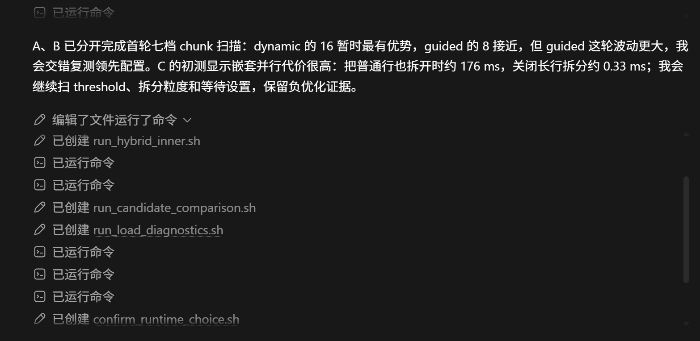
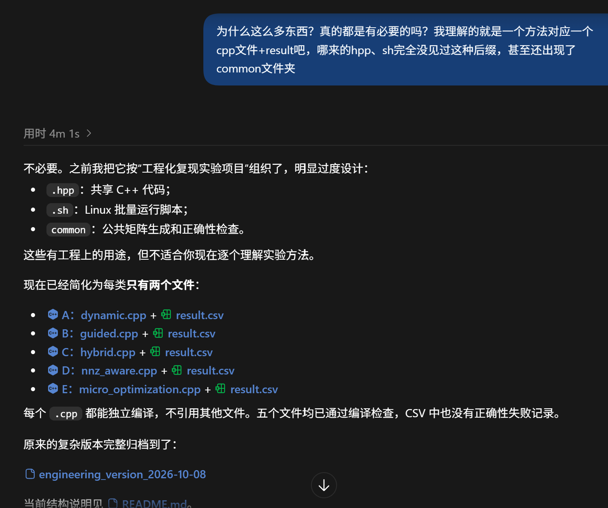
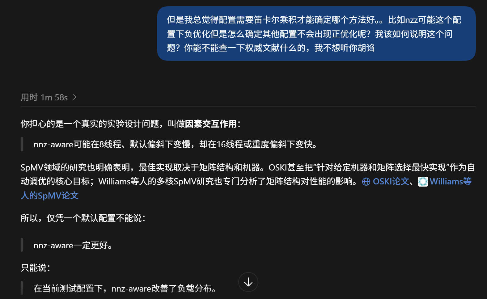
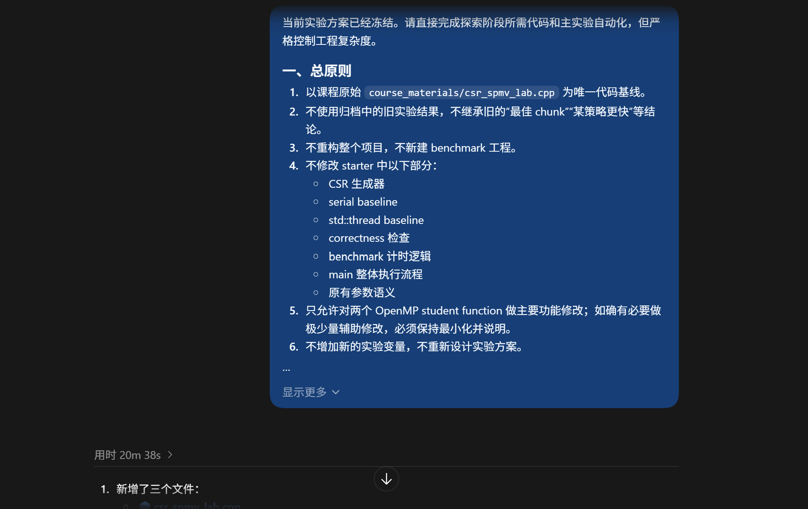

# 心路历程

GitHub仓库：https://github.com/huyurong-ruc/openmp-csr-spmv

## 初步尝试

我先从课件中快速定位出static、dynamic、guided三种调度策略，又与ai交互了解到nnz-aware和hybrid，为了验证hybrid真实性，在微信搜索阅读量较高的公众号，看到一篇讲long-row的，和ai说的hybrid其实是一个意思，于是最终定下来static、dynamic、guided、nnz-aware、long-row五种方法。

考虑到师姐已经演示了static和nnz-aware，可以当作参考，为了探索不同策略，最终选定dynamic、guided、long-row。

确定完方法打算让ai直接帮我实现，codex给我生成了多达50个文件，各种sh、csv：

我认为本质上只需要5个cpp文件，每个文件都只把student1函数改成我预设的方法即可，于是形成了GitHub上传的第一个版本（a369812）。

后来发现如果只有5个写死的文件，只能得到少量固定的配置，手动修改配置太过于繁琐，这才理解到ai写的sh脚本是用来批量运行实验的。

## 实验设计

经过前期的纯AI式探索，我对这个实验的感受还是混乱的，决定先出一版实验方案。

我的第一想法是将实验指南中的五个变量全部做笛卡尔积，留下效果最好的，显然工作量太大了。线程数、调度策略、随机种子都很容易确定，但是偏斜程度和矩阵规模我不知道从何下手。AI直接给我提供了几组高中低三档参数配置，但缺乏依据。

它搜索后告诉我没有文献客观定义偏斜程度和矩阵规模的大小，我理解这个答复但还是不能接受。如果我按照他的建议做出来这个实验，设想师姐/老师问我你的参数怎么选的，我难道要说是ai给我的吗？听着也太不可信了。

左思右想决定向师姐求助。非常非常感谢师姐呀非常耐心专业地回答我的问题！师姐指出很多时候不存在最优方法，大中小也没有绝对界限，但正式科研可以参考现实应用场景。非常容易理解的一件事我之前完全没get到，ai也没有很好地回答我这个问题，导致一直兜圈子好几天。

得到答案后我再次回去找ai讨论，它说现实场景下的数据集规模太大了不适合做作业，或许是新的讨论又激发了他的思考，建议根据我的电脑缓存容量来确定规模，小规模缓存完全可以容纳，中规模接近缓存容量，大规模则明显超过缓存容量。终于找到了令我信服的参数配置！

考虑到实验的核心变量是偏斜程度，所以选定偏斜程度、chunk、线程数、策略作为主实验变量，一共形成225组配置，这个工作量是可以接受的。矩阵规模则作为扩展实验，先由主实验选出来表现好的几组配置再进行规模扩展。seed作为最终的鲁棒性测试。实验方案大功告成！（271f031）

方案明确后，代码实现和批量运行就可以交给AI了。

最后自己重构了一下文件夹目录，便形成了第一个正式版本的实验结果。（df27fe091387f9762d8fe0c91dbd2476e7b9d74c）

后续又补充了breakdown实验，吸取之前的教训，这次先自己写了实验设计再让AI写代码，进度比之前快得多。（ff1d792）

## 异常诊断与负优化

早期实验中发现到了16线程运行时间暴增，我先核实了WSL的CPU配置确认有16核，然后尝试8、10、12、14、16等线程数下的运行情况，发现到12核才开始异常，发现显式设置OMP_WAIT_POLICY=PASSIVE后性能明显改善，直接从5ms减到0.0几。恰好此时受到5h限额制裁，只能自己在WSL中反复比较不同wait policy的表现，最终确认确实是PASSIVE下耗时显著降低。最终将实验统一改为显式设置passive，顺利解决了16线程异常的问题。

## 反思与收获

整个实验带给我最大的感受是AI并非万能的。最开始过于依赖AI，有一点思路就想让他直接帮我做完，但是AI做实验的问题就是文件繁杂、缺乏依据。它确实能够很快地迭代代码，但是也经常因为考虑过于周道而生成很多没必要的文件，反而增加了人工理解和审核的时间精力成本。

收获就是以后做实验最开始就应该先确定详细的实验方案，包括实验目标、参数配置、评价标准等等，再让AI严格按照方案执行，不要上来就生成大量的代码。当然，也不要完全排斥AI的代码，比如他写的sh脚本我之前没见过就很排斥，自己实验后才发现非常有用。以及对于AI的回复要批判性思考，不能盲目相信他提出的算法和参数，发现异常时也要先控制变量重新测量，不能直接接受AI给出的解释。
