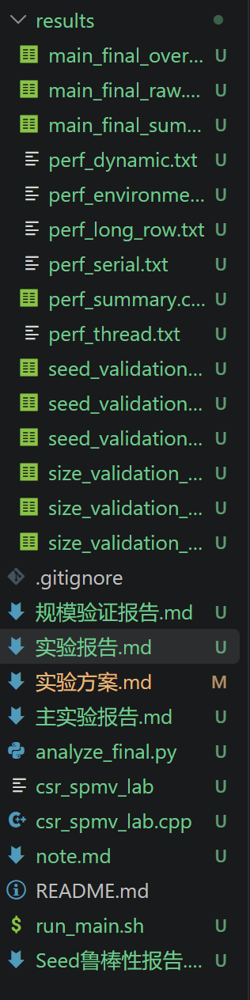

# 思考过程

最初拿到这个实验我先去翻看了自己的笔记和课件，定位出static、dynamic、guided三种调度策略，然后找ai了解到nnz-aware方法（也是师姐课上演示过的方法），我想知道有没有工业界常用的正规方法，问ai给我提供了hybrid法（即较短行串行，较长行并行），不知道其靠不靠谱，于是自己去微信搜索阅读量高的公众号，看到一篇讲long-row的，看下来和ai说的hybrid其实是一个意思，于是最终定下来static、dynamic、guided、nnz-aware、long-row五种方法。

确定完方法就让ai直接帮我做个baseline，codex给我生成了多达50个文件，各种sh、csv，聊天记录太长放不下，示例如下：

然后和ai一通讨论之后了解到他是按工程化思想做的，方便后续扩展，我让他缩减，其实本质上只需要5个cpp文件，每个文件都只改student1函数改成我确定好的方法即可，另外保留了他前期50个文件形成的result数据集，于是形成了GitHub上传的第一个版本（a369812ce63fe3101bc08a26415e0567e0b82fe7）。

然后我就开始思考，他给我的这五个文件其实完全不可信，如果只有5个写死的文件，那无论是线程数、偏斜程度还是矩阵规模等等都只有一个版本，手动修改太过于繁琐，然后才得知他之前写的sh文件就是用来程序自动循环跑代码的。

这时候觉得太乱了，完全不知道自己要做什么，决定先出个实验方案再让ai执行或许会好得多。到了实验方案环节看着线程数、偏斜程度、矩阵规模、调度策略、随机种子五个变量，我的第一想法就是做个笛卡尔乘积全部测一遍看哪个效果最好我就留哪个，显然工作量太大了，求助ai让我只测一个配置，留下表现好的两个再去扩展测试，但是我觉得不同策略在不同配置下的表现本身就是不一样的，我怎么确定我选的配置是公平的？然后ai又开始长篇大论输出，完全看不下去也看不懂了。

我决定先理清楚这几个变量配置，线程数直接取1、2、4、8、16，调度策略就那三个，随机种子随便取几个，那我该如何定义偏斜程度和矩阵规模？ai先是给了我几个现成的参数配置说这就是高中低偏斜程度，这就是大中小矩阵规模，我问他凭什么说这是高中低？有没有权威文献支持？他一通搜索后告诉我没有文献客观定义偏斜程度的大小和矩阵规模的大小，但是找到了对偏斜程度的计算方法，即我目前实验报告引用的那个。我理解这个答案但是还是不能接受，我难道要相信ai吗？如果我做出来这个实验报告，设想如果师姐/老师问我你的参数怎么选的，我难道要说是ai给我的吗？听着也太离谱了。

左思右想决定向师姐求助。非常非常感谢师姐呀非常耐心专业地回答我的问题！师姐指出其实很多时候并不存在最优方法，非常容易理解的一件事我之前完全没想到，遗憾ai也没有指出我这个问题，导致一直兜圈子好几天。我问偏斜程度和矩阵规模的大小该怎么定义，人为经验参数只能定义出来相对大小，比如我设计矩阵规模为10、100、1000，他们的确有相对大小，但是对于计算机而言其实都算是小批量了，师姐说确实没有定义，但是10、100确实太小了，可以从1000开始取，以及具体设计ai比较擅长可以问下ai，我说ai直接给我几组参数我不太相信他，想知道真实科研场景下如何处理这种问题，师姐说可以查一下真实场景下的数据集大小。得到答案后我再次回去找ai讨论，ai说现实场景下很多上亿的数据集，对我们这个作业来说规模太大了，或许是讨论又激发了ai的思考，他说可以查一下我的电脑性能，根据我的电脑内存来确定规模！这样就可以保证实现实验的真实目标，小批量完全可以自由执行，中批量卡线需要交换，大批量则远超内存需要较多交换，我非常认可这个实验方案。关于偏斜程度我最终选定了中等矩阵规模下进行偏斜程度的改变。

定下来5个变量的参数后面就顺利多了，如果拿5个变量一起跑太杂乱，又因为实验的核心环境变量就是偏斜程度，所以选定偏斜程度作为主实验，加上chunk、线程数、策略作为配置，一共形成225组配置，用程序来做的话这个工作量完全是可以接受的。矩阵规模则作为扩展实验，先由主实验选出来表现好的几组配置再进行规模扩展。seed则作为最终的鲁棒性测试。实验方案大功告成！（271f031f911deb2dadbd2b0f7c831a4182bcf996）

定档下来实验方案，之后的代码实现就比较容易了，把方案发给ai一顿输出就得到了现在的代码结果，但问题依然是太多、太乱，如下：

ai做实验的问题就是太过于周密，各种中间数据csv、主实验报告、扩展实验报告、鲁棒性报告……以及旧的实验也不会删，全部放进归档，这一点我理解他是在备份，但是我觉得完全没必要，他之前做的版本完全不能用，数据也是他在自己的沙盒跑的，在我的电脑上依然要重新跑来确定。最后删删改改把文件夹架构重构了一下，只保留一个主代码、sh循环运行代码、结果分析代码（225行csv不便于人眼分辨，所以写了个代码抽取其中的好方案）、实验方案、实验报告、result数据结果，非常简洁明了！接下来就是实验报告、心路历程的撰写了。

# 策略选择

调度策略上课讲过static、dynamic、guided，nnz-aware来自于ai，同时师姐也演示过，long-row来自于我去微信公众号搜索工业界常见做法。

因为师姐演示的baseline已经做了static和nnz-aware了，可以直接当作参考，为了探索一下不一样的策略所以选取了dynamic、guided、long-row这三种。

# 遇到的 bug、数据竞争、错误结果或负优化，以及如何想办法解决

最开始ai直接根据我的实验方案写的代码，到了16线程时耗时暴增，先是再次检查确定我的电脑真的有16核，然后找ai求助，他发现如果把openmp改成passive直接从5ms减到0.0几，遗憾此时受到5h限额制裁，只能根据codex的发现自己排查，我去wsl多试了几遍passive和active，发现不是代码或者设备的原因，多次尝试都是passive远好于active，找到gpt聊天界面询问得知是因为电脑默认active，即一直忙等待，之后改为显式设置passive顺利解决了16线程异常的问题